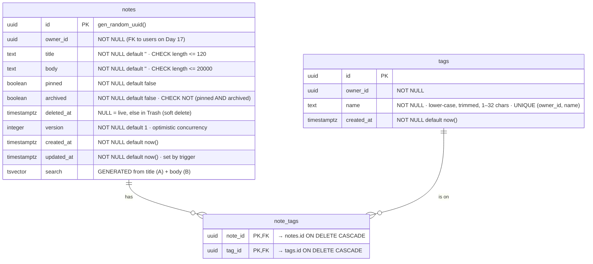

# Ìrántí

**Ìrántí** ("remembrance" in Yoruba) is a calm notes app with pinned notes, tags, full-text search, archive and trash. It autosaves while you type and never silently overwrites a note that changed in another tab. It is Day 16 of my 30-day dev challenge, and the day's subject is **Next.js + PostgreSQL**. On Days 12–15 every page read typed seed data through `lib/data.ts`. Here, that module is replaced by plain SQL against a real PostgreSQL database on Neon, with no ORM yet (that comes on Day 30), so I can see exactly what an ORM would be doing for me.

> **Public demo.** There are no accounts yet (Day 17), so everyone who opens the site shares the same notes. Don't write anything private in it.

## What it does

- **Notes list:** pinned notes first, then the most recently edited. "Load more" pages through the list using **keyset pagination**.
- **Editor:** autosaves 800 ms after you stop typing, and shows *Saving…*, *Saved* or *Couldn't save, retrying*. If the note changed elsewhere, it shows **"This note changed elsewhere"** and lets you *reload the other version* or *keep mine*.
- **Pin and archive** respond instantly with `useOptimistic`. Archived notes leave the main list but stay editable at **/archive**.
- **Delete** moves a note to **/trash** (a soft delete). From there you can restore it, delete it forever, or empty the whole trash.
- **Tags:** add and remove them in the editor, filter the list by tag, and see note counts per tag on **/tags**. A tag disappears when its last note lets go of it.
- **Search** uses PostgreSQL's own full-text search, with the matched words highlighted. The query lives in the URL (`/?q=jollof`), so you can share a search and it survives a refresh.
- **Layout:** light and dark themes with no flash, keyboard shortcuts (`n` for a new note, `/` to search), and support down to 360 px. On phones the list and the editor are separate screens; on wide screens they sit side by side.

## Stack

Next.js 16.4 (App Router, Cache Components) · TypeScript (strict, with `noUncheckedIndexedAccess`) · Tailwind CSS v4 · PostgreSQL on Neon through `@neondatabase/serverless` · Zod 4. There are no other UI or state libraries.

## Run it locally

1. **Create the database.** Make a free project at [console.neon.tech](https://console.neon.tech) (pick the region closest to where you'll deploy; this one uses Frankfurt, `eu-central-1`). Open **Connect**, switch **Connection pooling on**, and copy the connection string. Its host contains `-pooler`.
2. **Add the connection string.** Copy `.env.example` to `.env.local` and paste the string as `DATABASE_URL`. `.env.local` is git-ignored, so the password never reaches GitHub.
3. **Install, migrate, seed, run:**

   ```bash
   npm install
   npm run db:migrate   # creates the tables (safe to run again: it skips applied files)
   npm run db:seed      # 12 sample notes with tags (safe to run again: it adds only what's missing)
   npm run dev          # http://localhost:3000
   ```

Other scripts: `npm run db:explain` prints the query plans shown below, `npm run check:contrast` checks every colour pair, and `npm run typecheck` runs `next typegen` and then `tsc --noEmit`. The scripts in `scripts/` are plain TypeScript (`.mts`), which Node 22.18+ runs directly with no build step.

## Deploy to Vercel

1. Push the repo to GitHub and import it in Vercel.
2. In **Settings → Environment Variables**, add `DATABASE_URL` with the **pooled** Neon string, for Production and Preview.
3. In **Settings → Functions**, set the region next to the database (Frankfurt, `fra1`, for `eu-central-1`). Every query is a round trip, so this matters (see "One request, one transaction" below).
4. Run `npm run db:migrate` (and `npm run db:seed` if you want sample notes) from your machine against the same database. The build never touches the database, so it works without any database access at all.

### Why the pooled connection string?

PostgreSQL starts a separate server process for every connection, so it can only hold a few hundred at once. On Vercel, each request may run in a fresh, short-lived function instance, and a burst of traffic can start hundreds of them. Each one connecting directly would exhaust the database's connection limit, and new visitors would get errors. The **pooled** endpoint puts PgBouncer in front of PostgreSQL: it accepts thousands of client connections and lends each one a real connection only for the length of a transaction. Many short-lived functions share a handful of real connections. (`db:migrate` uses `DATABASE_URL_UNPOOLED` if you set it, because schema changes are better run on one real session.)

## The schema



| Index | On | Serves |
|---|---|---|
| `notes_live_list_idx` | `(owner_id, pinned DESC, updated_at DESC, id DESC) WHERE deleted_at IS NULL AND NOT archived` | the main list and "Load more" |
| `notes_archive_idx` | `(owner_id, updated_at DESC, id DESC) WHERE deleted_at IS NULL AND archived` | /archive |
| `notes_trash_idx` | `(owner_id, deleted_at DESC, id DESC) WHERE deleted_at IS NOT NULL` | /trash |
| `notes_search_idx` | `GIN (search)` | full-text search |
| `tags_owner_name_key` | `UNIQUE (owner_id, name)` | "find my tag called X", and the tag upsert |
| `note_tags_pkey` | `(note_id, tag_id)` | "the tags of this note" |
| `note_tags_tag_id_idx` | `(tag_id)` | the tag filter, the counts on /tags, and the cascade when a tag is deleted |

**Why each piece exists.** Every table, column, constraint and index is explained in a comment next to it in [`db/migrations/`](db/migrations). In short:
- **uuid ids** can appear in URLs without revealing how many notes exist.
- **`NOT NULL DEFAULT ''`** gives "no title" exactly one spelling, so no query has to handle both `''` and `NULL`.
- **CHECK constraints** hold even for code that skips Zod, or for someone editing in the Neon console.
- **`timestamptz(3)`** stores an exact instant at millisecond precision, the same precision as a JavaScript `Date`, which the pagination cursor relies on.
- **`deleted_at`** is the only nullable column, because `NULL` there *means* something: the note is live.
- **The join table** turns many-to-many into rows that can be counted and indexed. Its composite primary key stops the same tag being added to a note twice. `ON DELETE CASCADE` removes the links when a note or tag is deleted for good.
- **Every index** exists for a query the app actually runs. Each one speeds up reads and slows every write a little.

## Migrations, not hand edits

The schema is four numbered SQL files in [`db/migrations/`](db/migrations). [`scripts/migrate.mts`](scripts/migrate.mts) runs each pending file in its own transaction and records it in a `schema_migrations` table, so it never runs twice. It also stores each file's checksum and warns if an already-applied file was edited later. 004 shows how a schema grows: it `ALTER`s the table that 001 created rather than editing 001.

Why not just click "add column" in the Neon console? Because then the schema exists only in that one database. With migrations:
- every copy (mine, a teammate's, a preview branch, production) is built by the same steps in the same order;
- the schema's history sits in git next to the code that needs it;
- a fresh database is one command away.

PostgreSQL can even roll back `CREATE TABLE`, so a typo halfway through a file leaves no half-built schema behind.

## Pages barely changed shape

On Day 15 a page did this:

```ts
// Day 15: lib/data.ts filtered an array of typed seed data
const sections = await getMenuSections(query)
```

Today a page does this:

```ts
// Day 16: lib/notes.ts runs SQL against PostgreSQL
const page = await listNotes(ownerId, { tag: query.tag })
```

Same shape: an `async` function from a `server-only` module, typed arguments in, typed and validated data out. Pages and Server Actions never write SQL. All of it lives in two files:
- [`lib/db.ts`](lib/db.ts), the connection: the only file that reads `DATABASE_URL`;
- [`lib/notes.ts`](lib/notes.ts), the queries: every one parameterised, filtered by owner, and checked with Zod.

Both start with `import 'server-only'`, so importing them from a Client Component is a build error and the database password can never be bundled for the browser.

**Rows are validated at the boundary.** The driver types every row as `Record<string, any>`. Each query result goes through a Zod schema ([`lib/schema/note.ts`](lib/schema/note.ts)) before the rest of the app sees it. That turns `any` into real types, and it means a renamed column fails loudly at the query that broke, instead of turning up as `undefined` three components later. It costs microseconds for a page of 20 rows.

## SQL injection, and why this code is safe from it

SQL injection happens when user input is **pasted into the text** of a query:

```ts
// ❌ NEVER: the search box becomes part of the SQL
await sql.query(`SELECT * FROM notes WHERE title = '${title}'`)
```

If someone types `x' OR '1'='1` into the title, the query becomes `... WHERE title = 'x' OR '1'='1'`, which is true for every row, including other people's notes. Typing `x'; DROP TABLE notes; --` is worse still. The database can't tell your SQL from theirs, because it all arrives as one string.

Every query here is **parameterised**. The SQL text and the values travel to PostgreSQL *separately*:

```ts
// ✅ tagged template: ${title} becomes $1, and the value is sent on its own
await sql`SELECT * FROM notes WHERE title = ${title} AND owner_id = ${ownerId}`

// ✅ the same thing with numbered placeholders
await sql.query('SELECT * FROM notes WHERE title = $1 AND owner_id = $2', [title, ownerId])
```

PostgreSQL parses the SQL first, with `$1` as a hole, and only then fills the hole with the value, as **data**. `x' OR '1'='1` is just an odd title that matches nothing. There isn't a single string-built query in the codebase. Even the optional filters are composed from nested `sql` fragments (`${tag ? sql\`AND t.name = ${tag}\` : sql\`\`}`), which stay parameterised. And because every query also filters on `owner_id` (taken from the server, never from the browser), a request can't reach another owner's notes even with a valid note id.

## One request, one transaction

Saving a note touches several rows: the note itself, new tags, tag links removed, tag links added, unused tags deleted. **Without a transaction**, each of those statements is committed on its own. If the connection drops after the note is saved but before its tags are, you get a note with half its tags, or a link that was meant to go, and nothing puts it right. Readers could also catch it halfway, with the new title and the old tags. Inside a transaction, everyone sees either the old note with its old tags or the new note with its new tags, and any error undoes all of it.

At first, `saveNote` was an *interactive* transaction over a WebSocket: `BEGIN`, then each statement, then `COMMIT`. Measured from Nigeria to Neon in Frankfurt, each statement cost one round trip of about 250 ms, so one autosave took about 2.5 s. It is now a **single request** ([`sqlTransaction`](lib/db.ts)): one statement made of **data-modifying CTEs** that hand their `RETURNING` rows from step to step, plus the orphan-tag cleanup, both inside one transaction. Every tag step starts from `saved`, the row the version-checked `UPDATE` returned, so if the version didn't match, nothing flows through and no tag is touched. Saves now take one round trip. The interactive style is still in [`scripts/migrate.mts`](scripts/migrate.mts) and [`scripts/seed.mts`](scripts/seed.mts) for comparison.

## Optimistic concurrency: "This note changed elsewhere"

Every note has a `version`. The editor remembers the version it loaded, and each autosave sends it along:

```sql
UPDATE notes SET title = $1, body = $2, version = version + 1
WHERE id = $3 AND owner_id = $4 AND version = $5   -- $5: the version I started from
```

If another tab or device saved in between, the version has moved on, **no row matches**, and nothing is overwritten. The editor stops autosaving and offers a choice:
- **Reload the other version** replaces your text with theirs.
- **Keep mine** saves your text on top of theirs, now that you've seen the warning.

The `UPDATE` also locks the row until commit, so two saves at the same instant go one after the other, and the second one re-checks the version and fails. Pin, archive and trash don't use the version: they are single switches where the last click wins, so pinning a note in the list never makes the open editor think it was overwritten.

**Try it with two tabs:**
1. Open the same note in two tabs, A and B.
2. Type in **A** and wait for *Saved*.
3. Switch to **B** (it still has the old version) and type a word. Within a second, B shows *This note changed elsewhere* and *Not saved*.
4. Choose **Keep mine** in B, then go back to A and type again. Now A gets the warning. Choose **Reload the other version** to pull in B's text.

## `updated_at` is kept by a trigger

`notes_set_updated_at` ([001](db/migrations/001_notes.sql)) is a `BEFORE UPDATE` trigger: a function PostgreSQL runs on every update of a row, before writing it. When the title, body or version changed, it sets `updated_at = now()`. **App code can forget; a trigger can't.** It applies to every writer: Server Actions, the seed script, a future mobile API, or someone fixing data in the Neon console. It also encodes a rule in one place: pinning, archiving or trashing a note is not "editing", so it doesn't move the note to the top. If app code set `updated_at`, every `UPDATE` would have to remember that rule.

## Full-text search, not `LIKE '%word%'`

Migration [004](db/migrations/004_full_text_search.sql) adds `search`, a **generated** `tsvector` column. PostgreSQL computes it on every insert and update from the title (weight A) and body (weight B), and app code can't forget to update it. A **GIN index** maps each word to the notes that contain it, like the index at the back of a book. Queries use `websearch_to_tsquery`, which understands what people type into search boxes:
- `jollof rice` matches notes with both words;
- `"egusi soup"` matches the phrase;
- `beans -moi` leaves out notes with "moi";
- `rice or yam` matches either word.

`ts_rank` sorts the results so title matches come first, and `ts_headline` marks the matched words. It uses two private-use characters rather than `<b>` tags, and React turns them into `<mark>`, so no HTML string is ever injected.

`LIKE '%word%'` can't use an index (the leading `%` means "anywhere", so every row must be read), doesn't understand word forms ("cooking" doesn't match "cook"), can't rank, and matches inside other words ("pan" matches "Japan"). The plans below show the difference.

## Keyset pagination, not OFFSET

"Load more" sends a **cursor**: the sort key `(pinned, updated_at, id)` of the last note shown, encoded as an opaque string and checked with Zod when it comes back. The next page is

```sql
WHERE (n.pinned, n.updated_at, n.id) < ($cursor_pinned, $cursor_updated_at, $cursor_id)
ORDER BY n.pinned DESC, n.updated_at DESC, n.id DESC LIMIT 21
```

That is a **row comparison**, which the list index answers by jumping straight to the cursor's position. (A page is 20 notes; asking for 21 tells us whether there is a next page without a separate `count(*)`.) `OFFSET 4000` instead makes PostgreSQL produce and throw away 4,000 rows every time, so it gets slower with every page. It also *skips or repeats* notes when the list changes between clicks: edit a note while paging and every later note shifts by one. The `id` tie-breaker makes every position unique, and `timestamptz(3)` makes the cursor's timestamp round-trip exactly through JavaScript.

## EXPLAIN output

From `npm run db:explain` (trimmed; the full output includes the per-row tag subquery). Part 2 adds 25,000 notes **inside a transaction and rolls them back**, so the real data is untouched.

**Main list, real data (12 notes):** an index scan on the partial index, already in sort order, so there is no Sort step.

```
Limit (actual time=0.035..0.106 rows=10.00 loops=1)
  ->  Index Scan using notes_live_list_idx on notes n (actual time=0.035..0.104 rows=10.00 loops=1)
        Index Cond: (owner_id = '00000000-0000-4000-8000-000000000016'::uuid)
Execution Time: 0.132 ms
```

**Main list with 25,000 more notes:** the same plan. It reads 21 rows and stops.

```
Limit (actual time=0.036..0.116 rows=21.00 loops=1)
  Buffers: shared hit=39
  ->  Index Scan using notes_live_list_idx on notes n (actual time=0.035..0.113 rows=21.00 loops=1)
Execution Time: 0.143 ms
```

**"Load more" from the 4,000th note, keyset versus OFFSET:**

```
-- keyset cursor
Limit (actual time=0.020..0.034 rows=21.00 loops=1)
  Buffers: shared hit=5
  ->  Index Scan using notes_live_list_idx on notes n
        Index Cond: ((owner_id = '…'::uuid) AND (ROW(pinned, updated_at, id) < ROW(false, '2026-10-12 20:14:34.336+00', '75f1…'::uuid)))
Execution Time: 0.054 ms

-- OFFSET 4000
Limit (actual time=15.892..15.940 rows=21.00 loops=1)
  Buffers: shared hit=6541
  ->  Result (actual time=6.527..15.776 rows=4021.00 loops=1)
        ->  Sort (actual time=6.479..6.674 rows=4021.00 loops=1)
              ->  Seq Scan on notes n (actual time=0.014..3.450 rows=5010.00 loops=1)
                    Rows Removed by Filter: 20002
Execution Time: 15.974 ms
```

Keyset read **5 buffers in 0.05 ms**. OFFSET read **6,541 buffers in 16 ms**, and that gap grows with every page.

**Search for "jollof" (11 matching notes among 25,000):**

```
-- full-text search: GIN index
Bitmap Heap Scan on notes n (actual time=0.020..0.034 rows=11.00 loops=1)
  Recheck Cond: (search @@ '''jollof'''::tsquery)
  ->  Bitmap Index Scan on notes_search_idx (actual time=0.010..0.011 rows=11.00 loops=1)
Execution Time: 0.068 ms

-- the same search with ILIKE '%jollof%'
Seq Scan on notes n (actual time=0.016..4.331 rows=11.00 loops=1)
  Filter: (… AND ((title ~~* '%jollof%'::text) OR (body ~~* '%jollof%'::text)))
  Rows Removed by Filter: 25001
Execution Time: 4.373 ms
```

The GIN index goes straight to the 11 matches. `ILIKE` reads all 25,012 rows to find them. That is 64 times slower here, and the gap grows with the table.

## Caching and revalidation

With Cache Components, nothing is cached unless a function says `'use cache'`. The list reads in `lib/notes.ts` do, and each one is labelled with a cache tag. Every tag includes the owner, so one person's edit never expires anyone else's cache. `getNote` (the editor) is deliberately **not** cached: the editor must start from the latest version, because a stale copy would make the very next autosave look like a conflict.

After a write, each Server Action calls **`updateTag`** on only the tags that write affected:

| Action | Tags expired |
|---|---|
| Create a note | `notes:{owner}` |
| Autosave | `notes:{owner}` (or `archive:{owner}` if archived) · `tags:{owner}` only if tag links changed |
| Pin / unpin | `notes:{owner}` |
| Archive / unarchive | `notes:{owner}` · `archive:{owner}` |
| Move to trash / restore | `notes:` or `archive:{owner}` · `trash:{owner}` · `tags:{owner}` (counts skip trashed notes) |
| Delete forever / empty trash | `trash:{owner}` · `tags:{owner}` |
| Load more | nothing (it's a read) |

**Why `updateTag`** and not the alternatives:
- `updateTag` expires the entry immediately, so the re-render that comes back with the action's response reads fresh data: you always see your own change.
- `revalidateTag(tag, 'max')` is stale-while-revalidate. The next request is served the old list while a new one is fetched in the background. That's fine for a CMS webhook, but wrong right after you pinned a note.
- `revalidatePath('/')` would throw away every cached result on the page, including ones the write didn't touch.

The build never queries the database: `getOwnerId()` calls `connection()`, which marks everything after it as request-time work. The static shell (header, search box, skeletons) is prerendered, and the notes stream in.

## No accounts yet, but every row has an owner

Every row has an `owner_id`, every query filters on it, and Server Actions never accept an owner from the browser. Today [`lib/owner.ts`](lib/owner.ts) returns one fixed demo owner, `00000000-0000-4000-8000-000000000016`. On Day 17 only the body of `getOwnerId()` changes, to read the signed-in user from the session cookie. Every query, action and page stays as it is, and a migration adds a `users` table and turns `owner_id` into a foreign key.

## 404s

`/notes/hello` gets a real **404 status** from [`proxy.ts`](proxy.ts), which rejects anything that isn't a UUID before the page renders. PostgreSQL would reject `"hello"` as a uuid with an error, and a bad link deserves a 404, not an error page. A well-formed but unknown id needs the database to answer, which happens after the page's static shell has started streaming. That page shows the same not-found screen with a `noindex` tag, but keeps the 200 status, as the Next.js docs describe for `notFound()` after streaming starts.

## Design: "adire indigo ink on paper"

Adire is Yoruba resist-dyed cloth: deep indigo on undyed cotton. A notes app is ink on paper. So:
- **Paper** (`#f5f0e5`), a warm off-white, is the page.
- **Adire indigo** (`#18204c` for text, `#222c6e` for buttons) is the ink for text, headings and buttons.
- **Highlighter lime** (`#c8f03e`) is the single accent, used sparingly: the *Pinned* label, search highlights and the focus halo. It only ever sits **behind** dark indigo text (13.2:1), never as text on paper, where it would be unreadable.
- **Dark mode** is deep indigo-black (`#0c0e1b`) with soft paper-coloured text (15.4:1 against the page), the same lime, and a lime focus ring.
- **Errors** use a cool crimson. There is no orange, peach or tangerine anywhere.

Every colour is a token in the Tailwind `@theme` block, defined once as `light-dark(light, dark)`. `--color-*: initial` removes Tailwind's default palette, so an off-brand class simply doesn't exist. `npm run check:contrast` checks 23 text and UI pairs in both themes against WCAG AA. All pass; the weakest are the input borders at 3.67:1 (light) and 3.77:1 (dark), against a minimum of 3:1.

**Fonts.** Young Serif for headings and Literata, a typeface made for long reading on screens, for note text and the UI. Both passed a two-part check:
1. their character maps include ẹ ọ ṣ and the combining tone marks;
2. rendering "Ẹ̀fọ́ riro" in Chrome shows the tone mark *stacked* on the dotted letter.

Fraunces, Newsreader and Spectral passed the first check but failed the second: they print the accent beside the letter. Young Serif has no ₦, so the font stack lists Literata next and the browser borrows that one glyph. The dotted rule under the header and title is drawn like the stitched resist lines of adire eleko, and the logo is an adire-style ring of dots.

## Accessibility

- **Keyboard:**
  - A skip link and a visible two-part focus ring (an indigo ring with a lime halo; lime in dark mode).
  - `n` creates a note and `/` jumps to search (both ignored while typing), `Esc` leaves a text field, and `Ctrl/⌘ S` saves now. All are listed on /about.
  - Row actions in the list appear on keyboard focus as well as hover.
- **Screen readers:**
  - The save status is a polite live region; the conflict banner uses `role="alert"`.
  - Pin, archive, "Load more" and trash actions announce what happened.
  - Every control has a label, and pin buttons use `aria-pressed`.
- **Reduced motion:** with `prefers-reduced-motion`, all animation is turned off.
- **Small screens:** checked at 360 px with no horizontal scroll, and buttons are at least 40 px tall.
- **Empty, loading and error states:** no notes, no search results, an empty trash, an empty archive and no tags each have their own message. Every page has a skeleton while loading. If the database can't be reached, a friendly *"Couldn't reach your notes"* screen offers *Try again*.

## Concepts and where they live

| Concept | File | One-line explanation |
|---|---|---|
| Numbered migrations | [`db/migrations/`](db/migrations), [`scripts/migrate.mts`](scripts/migrate.mts) | Append-only SQL files, each applied once and recorded in `schema_migrations` |
| Constraints | [`db/migrations/001_notes.sql`](db/migrations/001_notes.sql) | `NOT NULL`, `CHECK` and defaults make the database refuse bad data from any writer |
| Trigger | [`db/migrations/001_notes.sql`](db/migrations/001_notes.sql) | `updated_at` is set by PostgreSQL, so no writer can forget it |
| Many-to-many + cascade | [`db/migrations/002_tags.sql`](db/migrations/002_tags.sql) | `note_tags` with a composite primary key; links vanish with their note or tag |
| Partial, ordered indexes | [`db/migrations/003_list_indexes.sql`](db/migrations/003_list_indexes.sql) | One index per real query, holding only the rows that page can show |
| Generated column + GIN | [`db/migrations/004_full_text_search.sql`](db/migrations/004_full_text_search.sql) | PostgreSQL keeps `search` up to date; GIN finds words fast |
| Pooled connection | [`lib/db.ts`](lib/db.ts) | PgBouncer shares a few real connections among many serverless functions |
| Parameterised queries | [`lib/db.ts`](lib/db.ts), [`lib/notes.ts`](lib/notes.ts) | Values travel apart from the SQL text, so injection is impossible |
| Rows validated at the boundary | [`lib/notes.ts`](lib/notes.ts), [`lib/schema/note.ts`](lib/schema/note.ts) | Zod turns the driver's `any` rows into checked types |
| Transaction in one request | [`lib/notes.ts`](lib/notes.ts) (`saveNote`) | Data-modifying CTEs plus cleanup: all or nothing, in one round trip |
| Interactive transaction | [`scripts/seed.mts`](scripts/seed.mts), [`scripts/migrate.mts`](scripts/migrate.mts) | `BEGIN` … `COMMIT`/`ROLLBACK` over a WebSocket session |
| Optimistic concurrency | [`lib/notes.ts`](lib/notes.ts), [`components/notes/note-editor.tsx`](components/notes/note-editor.tsx) | `UPDATE … WHERE version = $expected`; no match means someone else saved first |
| Upsert | [`lib/notes.ts`](lib/notes.ts), [`scripts/seed.mts`](scripts/seed.mts) | `INSERT … ON CONFLICT DO NOTHING` relies on a unique constraint |
| GROUP BY with LEFT JOIN | [`lib/notes.ts`](lib/notes.ts) (`listTagsWithCounts`) | One row per tag, counting only notes outside the trash |
| Anti-join cleanup | [`lib/notes.ts`](lib/notes.ts) (`DELETE_ORPHAN_TAGS`) | `NOT EXISTS` finds tags no note uses any more |
| Soft delete | [`lib/notes.ts`](lib/notes.ts) | Trash sets `deleted_at`; only "delete forever" removes the row |
| Full-text search | [`lib/notes.ts`](lib/notes.ts) (`searchNotes`), [`components/notes/highlighted.tsx`](components/notes/highlighted.tsx) | `websearch_to_tsquery`, `ts_rank`, and `ts_headline` with safe markers |
| Keyset pagination | [`lib/notes.ts`](lib/notes.ts), [`lib/cursor.ts`](lib/cursor.ts), [`components/notes/note-list.tsx`](components/notes/note-list.tsx) | A row comparison against the last note's sort key; never OFFSET |
| EXPLAIN ANALYZE | [`scripts/explain.mts`](scripts/explain.mts) | The real plan, rows and timings, on data rolled back afterwards |
| Owner on every row | [`lib/owner.ts`](lib/owner.ts) | One function decides whose data it is; Day 17 swaps its body |
| `server-only` data layer | [`lib/db.ts`](lib/db.ts), [`lib/notes.ts`](lib/notes.ts) | Importing it from a Client Component is a build error |
| Cache tags + `updateTag` | [`lib/cache-tags.ts`](lib/cache-tags.ts), [`app/(app)/actions.ts`](app/(app)/actions.ts) | Each write expires only the cached reads it changed |
| Debounced autosave | [`components/notes/note-editor.tsx`](components/notes/note-editor.tsx) | Save 800 ms after the last key, one save in flight, retry with backoff |
| `useOptimistic` | [`components/notes/note-list.tsx`](components/notes/note-list.tsx), [`components/notes/shelf-list.tsx`](components/notes/shelf-list.tsx) | Pin, archive and delete show their result before the server answers |
| State in the URL | [`components/notes/search-box.tsx`](components/notes/search-box.tsx), [`lib/list-url.ts`](lib/list-url.ts) | `?q=` and `?tag=` make searches shareable and refresh-proof |
| 404 before render | [`proxy.ts`](proxy.ts) | A non-UUID id gets a real 404 status without touching the database |
| Error boundary | [`app/(app)/error.tsx`](app/(app)/error.tsx) | A database outage shows a friendly screen, not a crash |
| Design tokens | [`app/globals.css`](app/globals.css), [`scripts/check-contrast.mjs`](scripts/check-contrast.mjs) | One `@theme` block with `light-dark()` colours, checked against WCAG AA |

## Worth adding later (not built today)

- **Day 17 (accounts):** a `users` table, `owner_id` as a foreign key, and row-level security as a second safety net. Also composite foreign keys so a note can only be linked to its own owner's tags.
- **Auto-purge the trash:** delete notes trashed more than 30 days ago (a scheduled job or `pg_cron`).
- **Note history:** keep each version in a `note_versions` table, so a conflict could show a diff instead of a choice.
- **Live updates** between tabs (Postgres `LISTEN/NOTIFY` or polling), so the conflict rarely happens at all.
- **A Yoruba-aware search configuration** that ignores tone marks, so "efo" finds "ẹ̀fọ́" (the `unaccent` extension).
- Markdown rendering, sharing, attachments, offline mode and AI features were out of scope today.
